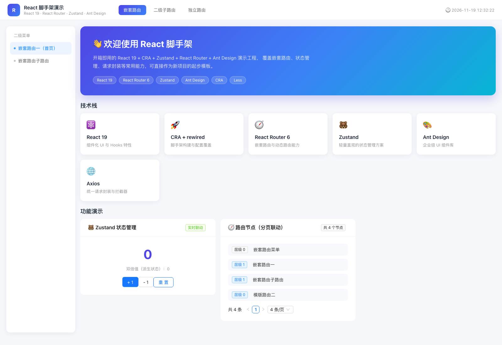

# React 脚手架模板



开箱即用的 React 前端起步模板（与 [vue3-scaffolding-template](https://github.com/buildlove/vue3-scaffolding-template) 风格功能保持一致），覆盖嵌套路由、状态管理、请求封装等常用能力，可直接作为新项目的起步脚手架。

## 核心版本

| 依赖 | 版本 | 说明 |
| --- | --- | --- |
| react / react-dom | 19.3.1 | 核心框架（Hooks） |
| react-router-dom | 6.30.6 | 路由（Hash 模式、嵌套路由） |
| zustand | 5.1.0 | 轻量状态管理 |
| antd | 5.29.3 | 企业级 UI 组件库（中文语言包） |
| axios | 1.21.1 | HTTP 请求（统一封装 + 拦截器） |
| react-scripts / react-app-rewired | 5.0.1 / 2.2.1 | CRA 构建与配置覆盖 |
| less / less-loader | 4.9.1 / 11.1.4 | Less 样式预处理 |
| typescript | 5.9.3 | TS 支持（可选，按需使用） |

## 环境要求

- Node.js >= 16（推荐 18 / 20 / 22）
- 包管理器推荐 [pnpm](https://pnpm.io/)（项目自带 pnpm-lock.yaml）

## 快速开始

```bash
# 1. 安装依赖（执行目录：项目根目录）
pnpm install

# 2. 启动开发服务（默认端口 3000）
pnpm start

# 3. 浏览器访问（Hash 路由）
# http://localhost:3000/#/template/template1
```

## 常用命令

| 命令 | 说明 |
| --- | --- |
| `pnpm start` | 启动开发服务（热更新，端口 3000） |
| `pnpm run build` | 生产构建（产物输出到 build/） |
| `pnpm test` | 运行单元测试（Jest + Testing Library） |

## 目录结构

```
├── public/index.html          # 应用入口 HTML
├── config-overrides.js        # CRA 配置覆盖入口（react-app-rewired）
├── webpack-config/            # webpack 定制配置（别名、Less、构建产物等）
├── pnpm-workspace.yaml        # pnpm 12 构建脚本放行配置
├── docs/                      # 文档与截图
└── src/
    ├── index.js               # 应用入口（挂载根组件）
    ├── App.js                 # 根组件（Ant Design 中文语言包 + Hash 路由）
    ├── index.less             # 全局样式（CSS 变量 / 浅色主题）
    ├── api/                   # 接口定义
    │   ├── index.js           # 接口统一出口
    │   └── user.js            # 示例接口
    ├── router/
    │   ├── index.js           # 路由出口（useRoutes 嵌套路由）
    │   └── routesMeta.js      # 路由元信息树（与 vue3 版 meta 字段一致）
    ├── store/demo.js          # Zustand 计数器演示仓库（state/派生值/actions 范例）
    ├── utils/request.js       # Axios 实例与拦截器（统一错误提示）
    └── views/                 # 页面组件
        ├── Layout.js          # 顶部导航布局（品牌 + 菜单 + 实时时钟）
        ├── TemplateLayer.js   # 二级菜单侧边栏（嵌套路由容器）
        ├── Template.js        # 首页（欢迎横幅 + 技术栈 + 功能演示）
        ├── Template2.js       # 独立路由页（Axios 请求演示）
        └── TemplateChild.js   # 嵌套路由子路由页
```

## 演示功能说明

- **嵌套路由**：顶部导航 + 二级侧边菜单，菜单与路由精确联动高亮（Hash 模式）
- **Zustand 状态管理**：首页计数器演示 state / 派生值（选择器）/ actions 标准写法
- **路由节点分页**：首页展示路由元信息树节点，antd Pagination 与列表真实联动
- **Axios 请求封装**：独立路由页手动触发请求，展示 loading 与结果（拦截器见 `src/utils/request.js`）
- **实时时钟**：顶部栏每秒刷新，演示定时器的创建与卸载清理

## 作为起步模板使用

1. **获取模板**：clone 或复制本项目到本地
2. **安装依赖**：`pnpm install`
3. **新增页面**：在 `src/views/` 新建组件，再到 `src/router/routesMeta.js` 添加节点
   - `meta.name`：路由名称（展示在首页节点列表与浏览器标题）
   - `meta.level`：层级（用于菜单分级展示）
   - `meta.node`：是否为叶子节点（首页节点列表筛选标记）
   - `element`：组件键名，并在 `src/router/index.js` 的 `elementMap` 中注册组件
4. **新增菜单**：顶部导航改 `src/views/Layout.js` 的 `navList`，二级菜单改 `src/views/TemplateLayer.js` 的 `menuList`
5. **新增接口**：在 `src/api/` 中定义函数，统一使用 `src/utils/request.js` 实例发起请求
6. **新增状态**：仿照 `src/store/demo.js` 用 `create` 定义 zustand 仓库
7. **个性化**：品牌名与导航改 `Layout.js`；主题色改 `src/index.less` 的 CSS 变量
8. **构建发布**：`pnpm run build`，将 `build/` 产物部署到静态服务器

## 常用配置

| 配置项 | 位置 | 说明 |
| --- | --- | --- |
| 路径别名 `@src` | config-overrides.js | 指向 src 目录 |
| 开发端口 3000 | react-scripts 默认 | 可用 PORT 环境变量覆盖 |
| 请求 baseURL | `.env` 中 `REACT_APP_BASE_URL` | 注入 `src/utils/request.js` |
| 构建产物路径 | webpack-config/overrideOutput.js | 默认输出到 /micro-apps/react18-scaffolding-template/ |
| 浏览器标题 | src/views/Layout.js | 根据路由 meta.name 自动生成 |
| 按需引入 | webpack-config/importBabel.js | antd 等库的 babel-plugin-import 配置 |

## 使用脚手架创建项目

### 安装脚手架工具

```bash
npm install -g leonwerth-cli
```

### 创建脚手架项目

```bash
leonwerth-cli
```

### 选择模板（目前绑定 react18 + antd + less 与第三方组件库的脚手架）

```text
liyang:leonwerth-cli liyang$ leonwerth-cli
? 选择脚手架模板: (Use arrow Keys)
> 1 react18-scaffolding-template
  2 vue3-scaffolding-template
```
